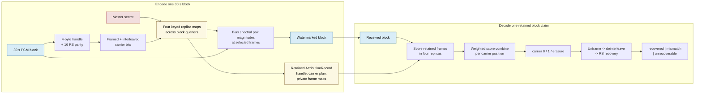
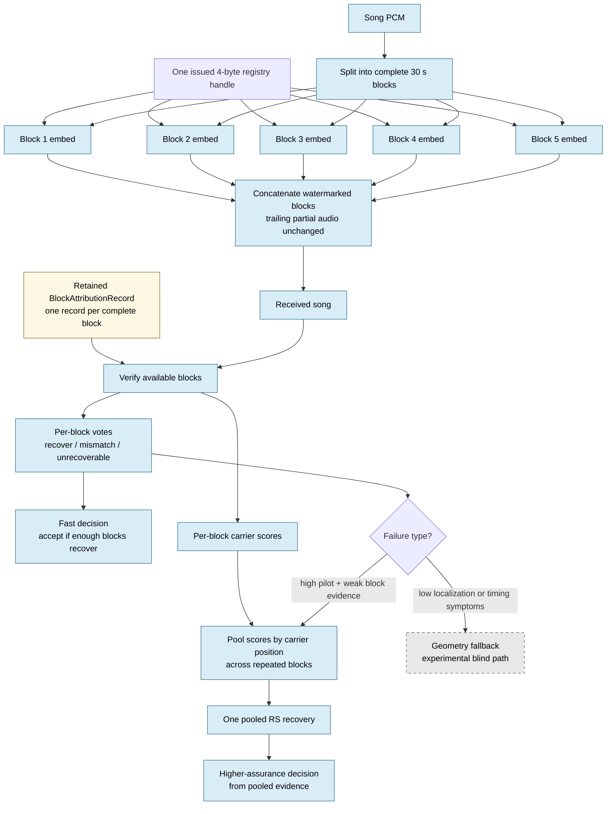

# Attribution V2 Visuals

These diagrams explain the current repeated-block attribution prototype. They
show retained-record verification and pooled block evidence; they do not claim
unknown-handle discovery, arbitrary crop recovery, codec robustness, or
perceptual transparency.

## 1. Single Block Encoding And Decoding

One 30-second block carries a four-byte opaque registry handle protected by
Reed--Solomon parity. The handle is not user metadata. It is a lookup key for a
retained authenticated registry record.



### Visual Example

```text
30 s block timeline

|---------- replica 1 ----------|---------- replica 2 ----------|---------- replica 3 ----------|---------- replica 4 ----------|
      bit 0  bit 1  bit 2 ...        bit 0  bit 1  bit 2 ...        bit 0  bit 1  bit 2 ...        bit 0  bit 1  bit 2 ...
       +      -      +                +      -      +                +      -      +                +      -      +

For carrier bit 2:
    replica scores:  +0.31, +0.44, erasure, +0.28
    combined score:  +0.36
    observed bit:    1

For carrier bit 7:
    replica scores:  +0.02, -0.01, erasure, +0.00
    combined score:  too weak
    observed bit:    erasure
```

**How to read it**

- The same carrier bit is embedded once in each of four block quarters.
- Weak evidence becomes an erasure instead of a confident guess.
- Reed--Solomon recovery consumes `2 * symbol_errors + symbol_erasures` from the parity budget.
- The retained frame map is private registry material. Without it, this single-block application path is not blind recovery.

## 2. Repeated Block Encoding, Voting, And Pooling

V2 repeats the same handle in each complete block. Verification can make a fast
decision from independent block votes, then use pooled carrier evidence for a
higher-assurance block-distress fallback.



### Visual Example

```text
2.5 minute song as five complete 30 s attribution blocks

| block 1 | block 2 | block 3 | block 4 | block 5 |
| handle A| handle A| handle A| handle A| handle A|

Fast block votes:

| Block | Single-block result | RS cost | Use |
| ---: | --- | ---: | --- |
| 1 | recovered | 4 | vote |
| 2 | recovered | 14 | vote |
| 3 | too costly / weak | 21 | evidence only |
| 4 | too costly / weak | 20 | evidence only |
| 5 | recovered | 3 | vote |

Fast vote result:
    3 recovered blocks -> accept a 2-vote or 3-vote policy

Pooled evidence result:
    combine carrier scores from blocks 1-5
    pooled carrier errors: 0
    pooled erasures:       0
    pooled RS cost:        0
    pooled decision:       recovered
```

**How to read it**

- Block voting answers: "How many independent blocks recovered the same claim?"
- Evidence pooling answers: "Can partial evidence from weak blocks produce one cleaner shared codeword?"
- Geometry fallback is not the first response to weak exact-looking blocks. It is reserved for localization or timing distress.
- Current production code implements retained-record block encoding and pooled verification in `src/stegosaurus/audio/attribution_core/blocks.py`.
- Blind window ranking and non-oracle geometry recovery remain archived experiment paths until promoted behind the same block and pooling contracts.

