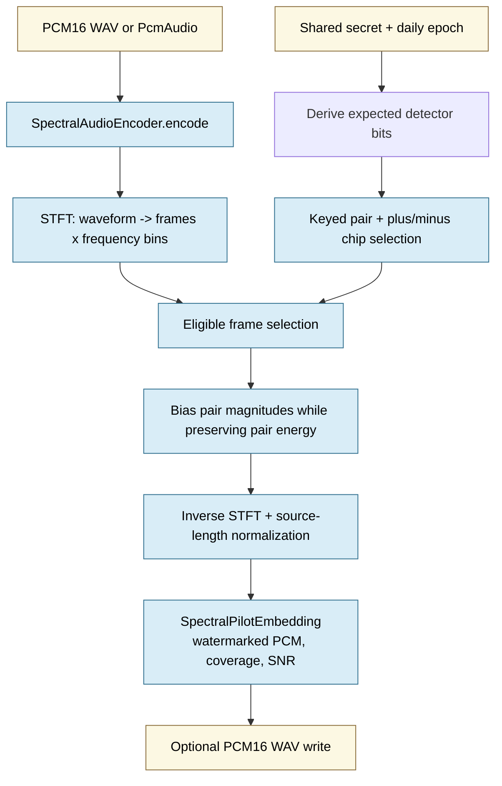
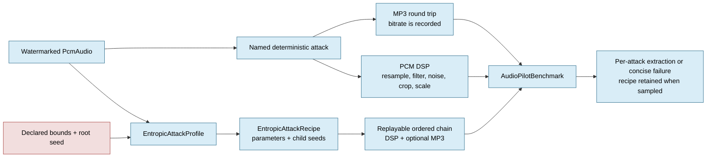
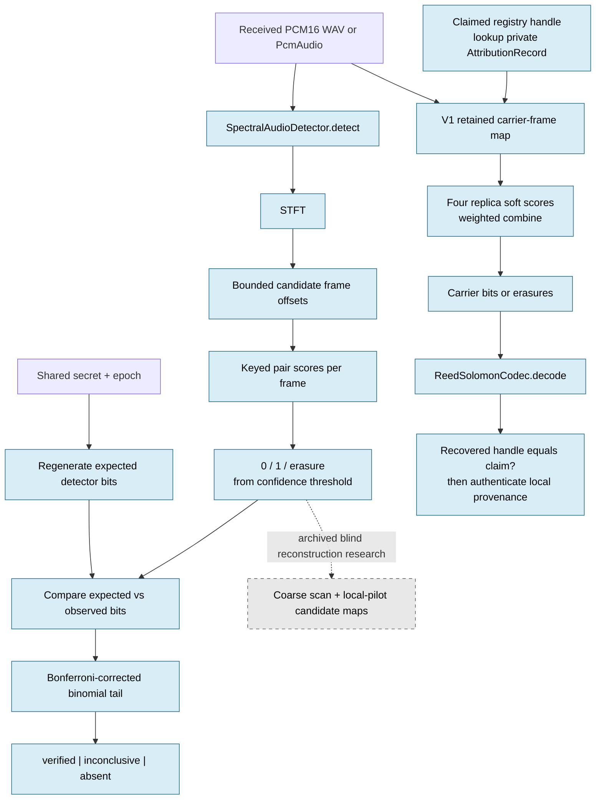
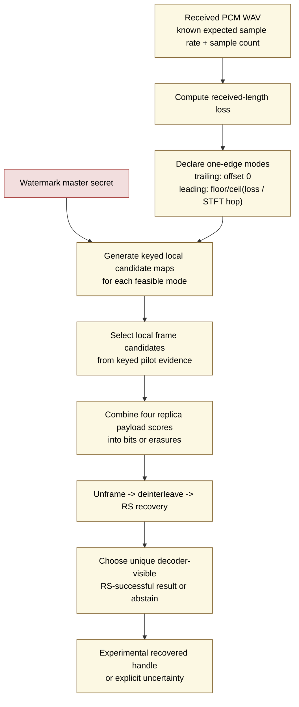
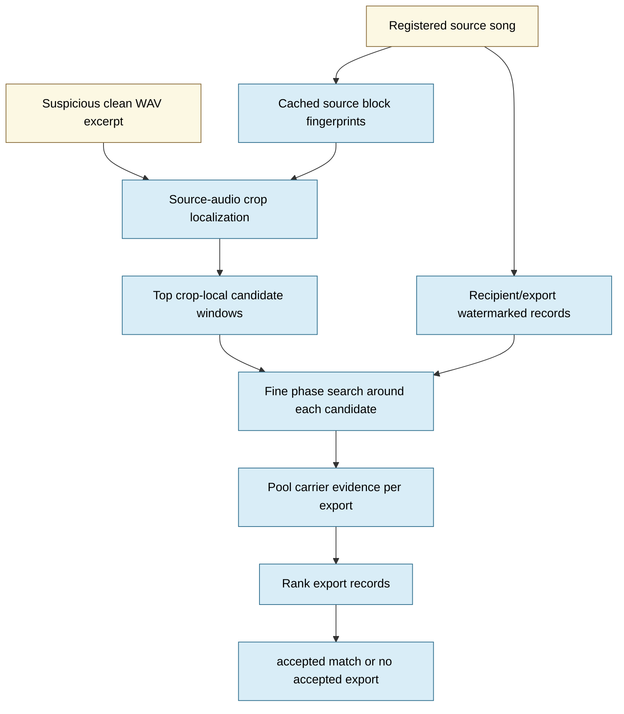

# Stegosaurus Process Diagrams

These Mermaid diagrams are source-controlled design maps for the current audio
pilot. Solid arrows describe implemented code. The v1 attribution route is a
claimed-handle verifier with a registry-retained private frame map; it does not
blindly discover unknown handles. Dashed arrows mark separate archived blind
reconstruction research. Iteration 032 adds a measured, bounded non-oracle
edge-crop experiment but does not change the v1 verifier. Render this file in a Mermaid-capable Markdown viewer;
the text and code maps remain useful if no renderer is present.

For the newer repeated-block attribution prototype, see
`docs/attribution_v2_visuals.md`. The V4 known-song workflow is documented in
section 5 below.

## 1. Encoding Scheme

**Interpretation**

- The current encoder carries a low-rate statistical pilot, not a production attribution handle.
- One expected detector bit is derived per frame from a secret and epoch; selected bin pairs receive repeated differential evidence.
- The pair-energy safeguard helps constrain the local operation, but does not certify perceptual transparency.

| Diagram step | Application code |
| --- | --- |
| Directional encoding API | `src/stegosaurus/audio/encoder.py:22`, `src/stegosaurus/audio/encoder.py:41` |
| Pilot orchestration | `src/stegosaurus/audio/pilot_workflow.py:31`, `src/stegosaurus/audio/pilot_workflow.py:58` |
| Expected keyed detector bits | `src/stegosaurus/audio/schema_engine.py:64` |
| STFT and inverse STFT | `src/stegosaurus/audio/pilot_transform.py:22` |
| Keyed pairs and spreading chips | `src/stegosaurus/audio/pilot_pairs.py:20` |
| Frame-local modulation | `src/stegosaurus/audio/pilot_frames.py:18` |
| PCM/WAV records and I/O | `src/stegosaurus/audio/pilot_types.py:1` |

## 2. Example Attack And Benchmark Scheme

**Interpretation**

- A named attack is one declared transformation with explicit parameters; it is not a claim about all variants of that transformation.
- An entropic profile samples only within pre-registered bounds. Its recipe makes the random draw replayable.
- The benchmark stores evidence per attack rather than turning a small fixture into a universal robustness score.

| Diagram step | Application code |
| --- | --- |
| MP3 codec boundary | `src/stegosaurus/audio/attack_core/codec.py` |
| Deterministic signal transforms | `src/stegosaurus/audio/attack_core/signal.py` |
| Entropic configuration and recipes | `src/stegosaurus/audio/attack_core/models.py` |
| Sampling and replaying a profile | `src/stegosaurus/audio/attack_core/profile.py` |
| Benchmark evidence records | `src/stegosaurus/audio/benchmark.py:67` |

## 3. Decoding Scheme

**Interpretation**

- Current detector decoding scans bounded offsets, produces soft frame evidence, and returns a corrected statistical status.
- Low-confidence frame observations become erasures rather than guessed bits.
- V1 attribution verifies a supplied registry-handle claim with a retained private frame map. It is not blind discovery and requires authenticated registry lookup outside the waveform.
- The dashed branch documents archived blind reconstruction research; its named synthetic crop measurements do not yet justify a v1 blind-decoding claim.
- Reed--Solomon can recover when `2 * unknown_symbol_errors + known_symbol_erasures <= parity_symbols`; the transport code reports erasures and correction diagnostics.

| Diagram step | Application code |
| --- | --- |
| Directional detection API | `src/stegosaurus/audio/detector.py:22`, `src/stegosaurus/audio/detector.py:41` |
| Offset scan and pilot extraction | `src/stegosaurus/audio/pilot_workflow.py:81` |
| Frame confidence and erasure decision | `src/stegosaurus/audio/pilot_frames.py:18` |
| Statistical decision and correction | `src/stegosaurus/audio/schema_engine.py:87` |
| V1 attribution encoder and decoder | `src/stegosaurus/audio/attribution_core/encoder.py`, `src/stegosaurus/audio/attribution_core/decoder.py` |
| Retained claim record and diagnostics | `src/stegosaurus/audio/attribution_core/models.py` |
| Local authenticated registry | `src/stegosaurus/audio/attribution_core/registry.py` |
| Four-replica carrier map and combine | `src/stegosaurus/audio/attribution_core/repetition.py` |
| Sync framing and interleaving transport | `src/stegosaurus/audio/transport_framing.py:20`, `src/stegosaurus/audio/transport_interleaving.py:17` |

## 4. Experimental Edge-Mode Non-Oracle Reconstruction

**Interpretation**

- This diagram describes `iteration_032_edge_mode_coarse_bank`, not the v1 application decoder.
- The expected waveform geometry supplies a bounded timing model; the decoder does not receive the retained carrier-frame map or expected handle while choosing a mode.
- The result applies only to the named 30-second synthetic fixture and `250 ms` single-edge leading/trailing crops measured in that experiment.

| Diagram step | Experiment code |
| --- | --- |
| Duration-derived edge modes and local reconstruction | `src/stegosaurus/audio/experiments/non_oracle_reconstruction/iteration_032_edge_mode_coarse_bank/run.py:55` |
| Transport deinterleaving and RS recovery | `src/stegosaurus/audio/transport_channel.py:53`, `src/stegosaurus/audio/transport_interleaving.py:17` |
| Measured result and limits | `src/stegosaurus/audio/experiments/non_oracle_reconstruction/iteration_032_edge_mode_coarse_bank/SUMMARY.md:1` |
| Channel recovery | `src/stegosaurus/audio/transport_channel.py:20` |
| Reed--Solomon boundary | `src/stegosaurus/audio/ecc.py:37` |

## Design Rules Captured Here

- Keep statistical presence detection separate from opaque attribution recovery.
- Record named transformations and replayable entropy recipes before interpreting resilience.
- Treat the v1 verifier as a claimed-handle prototype with a retained map. Keep the edge-mode no-map decoder experimental until broader independent validation covers waveform geometry errors, other edit models, and open-world controls.
- Do not interpret any diagram as a claim of codec, DSP, perceptual, corpus, or adversarial robustness beyond documented experiments.

## 5. V4 Known-Song Clean Leak Workflow

**Interpretation**

- This is the V4 clean-file product workflow, not unknown-song discovery.
- Source localization is shared once per selected song; only the top candidate
  windows fan out across recipient/export records.
- The measured release boundary is clean suspicious WAV excerpts. Recorded
  audio, normalization, lossy codec, platform processing, and resynthesis remain
  experimental.

| Diagram step | Application code |
| --- | --- |
| Song/export records | `src/stegosaurus/audio/attribution_workflow/models.py` |
| Source block fingerprints and excerpt localization | `src/stegosaurus/audio/attribution_workflow/fingerprints.py` |
| Phase-refined export fanout | `src/stegosaurus/audio/attribution_workflow/fanout.py` |
| Workflow facade | `src/stegosaurus/audio/attribution_workflow/workflow.py` |
| Tkinter demo controller | `src/stegosaurus/audio/demo_v4_controller.py` |
