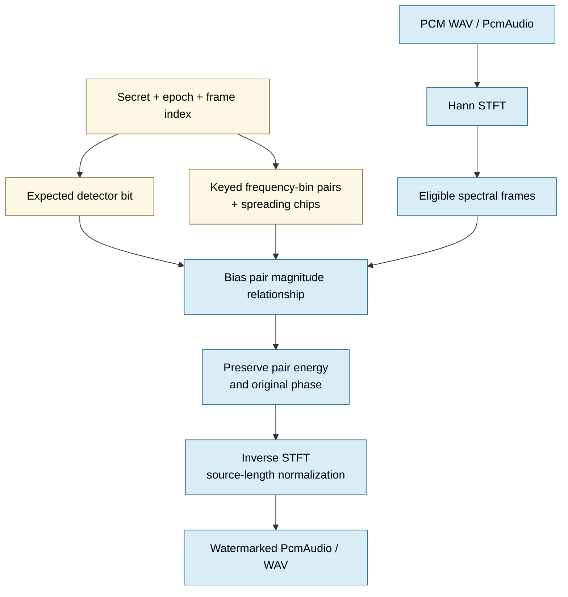
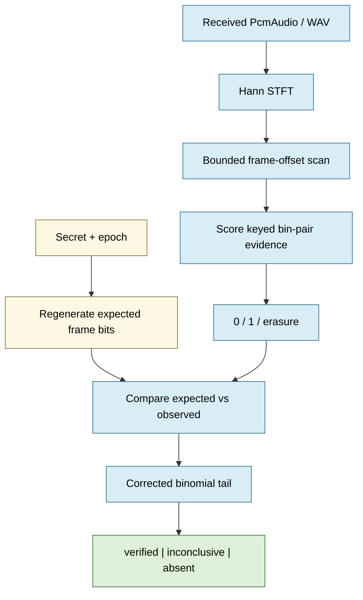
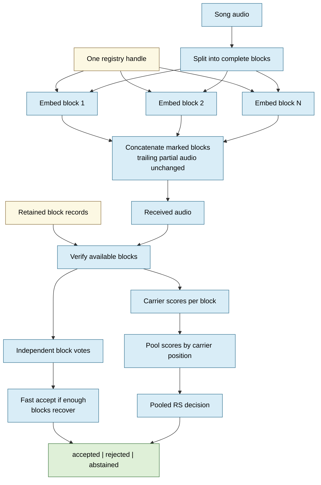
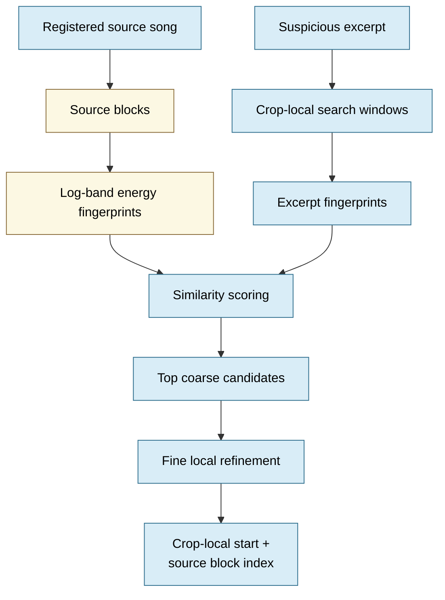
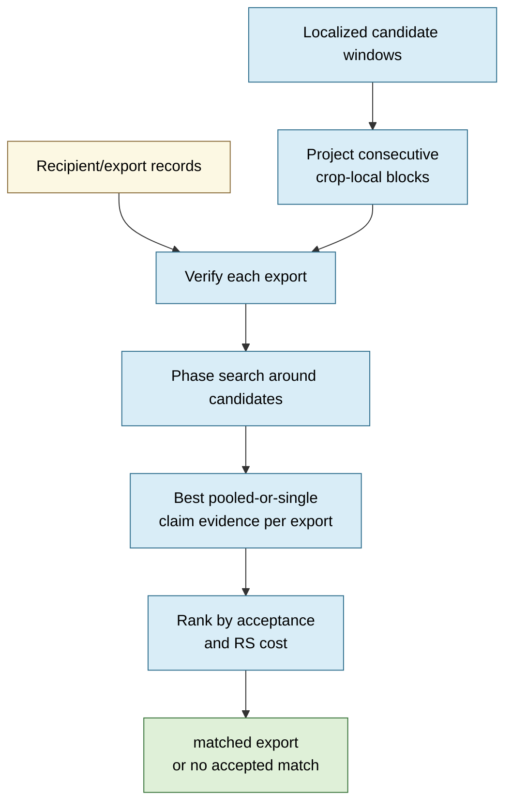
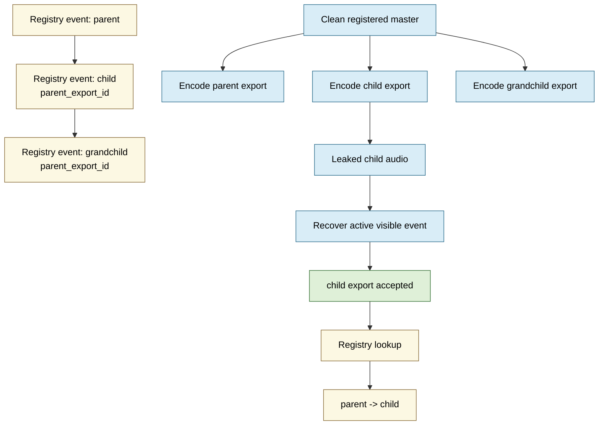
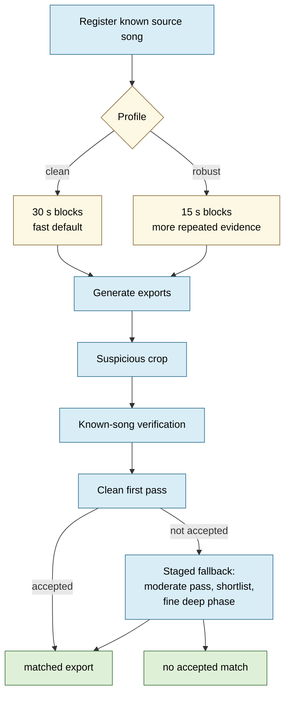
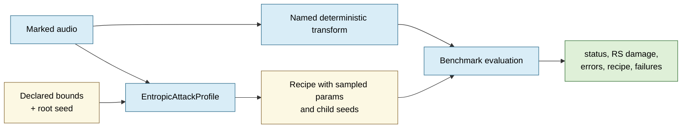
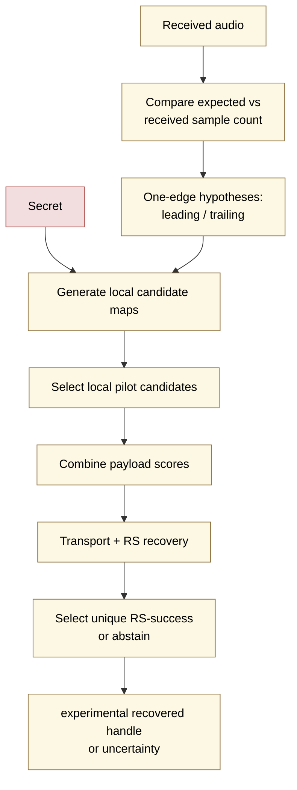

# Stegosaurus Visuals

This file is a fresh visual index for the main algorithmic processes in the
audio prototype. Each diagram is intentionally scoped: it shows what the process
does, what private information it needs, and where the current implementation
stops. These visuals are not robustness, perceptual, patent, or production
claims beyond the named measured experiments.

## 1. Spectral Pilot Encoding

**Question answered:** how does Stegosaurus add a keyed statistical presence
signal to audio?

**Scope:** implemented as a low-rate keyed presence pilot. Pair-energy
preservation is an engineering constraint, not proof of inaudibility.

**Where this happens**

| Visual step | File location |
| --- | --- |
| Public pilot encoding API | `src/stegosaurus/audio/encoder.py:22`, `src/stegosaurus/audio/encoder.py:41` |
| Pilot embed workflow | `src/stegosaurus/audio/pilot_workflow.py:58` |
| STFT and inverse STFT | `src/stegosaurus/audio/pilot_transform.py:22`, `src/stegosaurus/audio/pilot_transform.py:36` |
| Keyed bin-pair selection | `src/stegosaurus/audio/pilot_pairs.py:23` |
| Frame-local magnitude embedding | `src/stegosaurus/audio/pilot_frames.py:21` |
| Expected detector bits | `src/stegosaurus/audio/schema_engine.py:64` |

## 2. Spectral Pilot Detection

**Question answered:** does this received audio contain the expected keyed
presence signal?

**Scope:** this is statistical detection, not recipient attribution and not
public audio fingerprinting.

**Where this happens**

| Visual step | File location |
| --- | --- |
| Public pilot detection API | `src/stegosaurus/audio/detector.py:22`, `src/stegosaurus/audio/detector.py:41` |
| Bounded frame-offset scan | `src/stegosaurus/audio/pilot_workflow.py:81` |
| STFT analysis | `src/stegosaurus/audio/pilot_transform.py:22` |
| Frame score extraction | `src/stegosaurus/audio/pilot_frames.py:85` |
| Statistical detection decision | `src/stegosaurus/audio/schema_engine.py:87` |

## 3. Single-Block Claimed Attribution

**Question answered:** can a retained private record verify a supplied registry
handle claim for one block?

```mermaid
flowchart LR
    subgraph encode["Encode"]
        block["Audio block"] --> plan["4-byte handle\n+ RS parity"]
        plan --> carrier["Framed/interleaved carrier bits"]
        secret["Master secret"] --> map["Private four-replica\nframe maps"]
        carrier --> map
        map --> watermark["Embed carrier bits\nin selected frames"]
        watermark --> marked["Marked block"]
        map --> record["Retained AttributionRecord"]
    end

    subgraph verify["Verify supplied claim"]
        received["Received block"] --> score["Score retained frames"]
        record --> score
        score --> combine["Combine four replica scores"]
        combine --> bits["carrier bits / erasures"]
        bits --> rs["Unframe, deinterleave,\nRS recovery"]
        rs --> result["recovered | mismatch | unrecoverable"]
    end

    marked --> received

    classDef audio fill:#d9edf7,stroke:#31708f,color:#000;
    classDef private fill:#fcf8e3,stroke:#8a6d3b,color:#000;
    classDef decision fill:#dff0d8,stroke:#3c763d,color:#000;
    class block,watermark,marked,received,score,combine,bits,rs audio;
    class secret,map,record,plan,carrier private;
    class result decision;
```

**Scope:** retained-record claimed-handle verification. It does not discover
unknown handles from arbitrary audio.

**Where this happens**

| Visual step | File location |
| --- | --- |
| Claimed attribution encoder | `src/stegosaurus/audio/attribution_core/encoder.py:46` |
| Carrier planning and RS recovery | `src/stegosaurus/audio/schema_engine.py:126`, `src/stegosaurus/audio/schema_engine.py:134` |
| Four-replica frame-map embedding | `src/stegosaurus/audio/attribution_core/repetition.py:47` |
| Four-replica retained-record verification | `src/stegosaurus/audio/attribution_core/repetition.py:66` |
| Attribution record model | `src/stegosaurus/audio/attribution_core/models.py:65` |
| Claimed attribution decoder | `src/stegosaurus/audio/attribution_core/decoder.py:44` |

## 4. Repeated-Block Voting And Pooling

**Question answered:** how does a longer song accumulate attribution evidence
across multiple blocks?

**Scope:** implemented for retained block records. Pooling helps weak block
evidence, while crop/localization issues are handled by the known-song workflow.

**Where this happens**

| Visual step | File location |
| --- | --- |
| Block codec orchestration | `src/stegosaurus/audio/attribution_core/blocks.py:86` |
| Per-block embedding | `src/stegosaurus/audio/attribution_core/blocks.py:108` |
| Block verification and voting | `src/stegosaurus/audio/attribution_core/blocks.py:128` |
| Pooled claim recovery | `src/stegosaurus/audio/attribution_core/blocks.py:169` |
| Waterfall acceptance policy | `src/stegosaurus/audio/attribution_core/block_waterfall.py:60` |
| Tkinter demo controller entry points | `src/stegosaurus/audio/demo_controller.py:117`, `src/stegosaurus/audio/demo_controller.py:151` |

## 5. Known-Song Source Localization

**Question answered:** where does a suspicious excerpt appear inside a
registered song?

**Scope:** known-song localization. The user or registry must resolve a
candidate source song; this is not open-world music identification.

**Where this happens**

| Visual step | File location |
| --- | --- |
| Fingerprint index model | `src/stegosaurus/audio/attribution_workflow/models.py:32` |
| Song record model | `src/stegosaurus/audio/attribution_workflow/models.py:40` |
| Localization candidate model | `src/stegosaurus/audio/attribution_workflow/models.py:68` |
| Source fingerprint index build | `src/stegosaurus/audio/attribution_workflow/fingerprints.py:26` |
| Excerpt localization search | `src/stegosaurus/audio/attribution_workflow/fingerprints.py:38` |
| Coarse candidate and fine refinement | `src/stegosaurus/audio/attribution_workflow/fingerprints.py:80`, `src/stegosaurus/audio/attribution_workflow/fingerprints.py:89` |
| Log-band fingerprint extraction | `src/stegosaurus/audio/attribution_workflow/fingerprints.py:126` |

## 6. Export Fanout Verification

**Question answered:** once a song region is localized, which export record
matches the excerpt?

**Scope:** retained export-record fanout. The robust mode uses a more expensive
fallback search; it should be presented as an explicit mode, not a free default.

**Where this happens**

| Visual step | File location |
| --- | --- |
| Export record model | `src/stegosaurus/audio/attribution_workflow/models.py:56` |
| Verification result model | `src/stegosaurus/audio/attribution_workflow/models.py:89` |
| Fanout verification entry point | `src/stegosaurus/audio/attribution_workflow/fanout.py:25` |
| Per-export verification | `src/stegosaurus/audio/attribution_workflow/fanout.py:49` |
| Phase-search verification | `src/stegosaurus/audio/attribution_workflow/fanout.py:75` |
| Known-song workflow fallback orchestration | `src/stegosaurus/audio/attribution_workflow/workflow.py:131` |

## 7. Registry-Only Parent/Child Chain

**Question answered:** how can the app represent custody lineage without
stacking multiple visible watermarks in the same audio?

**Scope:** child exports are regenerated from the clean master. Parent-child
history is registry truth, not additional audio truth.

**Where this happens**

| Visual step | File location |
| --- | --- |
| Export record and parent link field | `src/stegosaurus/audio/attribution_workflow/models.py:56` |
| In-memory attribution catalog | `src/stegosaurus/audio/attribution_workflow/models.py:118` |
| Registry lineage lookup | `src/stegosaurus/audio/attribution_workflow/models.py:166` |
| Child export creation from clean source | `src/stegosaurus/audio/attribution_workflow/workflow.py:50` |
| V4 demo controller lifecycle helpers | `src/stegosaurus/audio/demo_v4_controller.py:82`, `src/stegosaurus/audio/demo_v4_controller.py:157` |

## 8. Clean Versus Robust V4 Profiles

**Question answered:** when should the app use the fast clean profile versus
the measured robust profile?

**Measured scope:** the 15-second robust profile passed the compact iteration
041 baseline: parent and child crops under clean, peak-normalized, and synthetic
light recorded-proxy conditions. This is not a general claim about arbitrary
recorded audio, lossy platforms, codecs, resynthesis, or unknown songs.

**Where this happens**

| Visual step | File location |
| --- | --- |
| Clean and robust block durations | `src/stegosaurus/audio/attribution_workflow/workflow.py:21`, `src/stegosaurus/audio/attribution_workflow/workflow.py:22` |
| Recovery profile model | `src/stegosaurus/audio/attribution_workflow/models.py:103` |
| Robust song registration | `src/stegosaurus/audio/attribution_workflow/workflow.py:40` |
| Staged fallback verification | `src/stegosaurus/audio/attribution_workflow/workflow.py:131` |
| Tkinter V4 demo controller | `src/stegosaurus/audio/demo_v4_controller.py:82`, `src/stegosaurus/audio/demo_v4_controller.py:157` |
| Tkinter waveform and playback surface | `src/stegosaurus/audio/demo_app.py:63`, `src/stegosaurus/audio/demo_app.py:190` |

## 9. Named Attack And Benchmark Recipes

**Question answered:** how are transformations made replayable rather than
hand-wavy?

**Scope:** attack recipes are evaluation artifacts. A passing named recipe is
not a claim about every version of that attack class.

**Where this happens**

| Visual step | File location |
| --- | --- |
| Attack evaluation model | `src/stegosaurus/audio/benchmark.py:28` |
| Entropic benchmark runner | `src/stegosaurus/audio/benchmark.py:92` |
| Per-attack benchmark execution | `src/stegosaurus/audio/benchmark.py:122` |
| Deterministic MP3 round trip | `src/stegosaurus/audio/attack_core/codec.py:24` |
| Entropic attack configuration and recipe | `src/stegosaurus/audio/attack_core/models.py:22`, `src/stegosaurus/audio/attack_core/models.py:128` |
| Entropic attack profile | `src/stegosaurus/audio/attack_core/profile.py:31` |

## 10. Experimental Non-Oracle Edge-Crop Reconstruction

**Question answered:** can an experiment recover a handle without the retained
private carrier map under a bounded crop model?

**Scope:** archived experiment path. It remains separate from application
verification until broader geometry, attack, and control validation exists.

**Where this happens**

| Visual step | File location |
| --- | --- |
| Archived edge-crop reconstruction experiment | `src/stegosaurus/audio/experiments/non_oracle_reconstruction/iteration_032_edge_mode_coarse_bank/run.py` |
| Archived experiment summary | `src/stegosaurus/audio/experiments/non_oracle_reconstruction/iteration_032_edge_mode_coarse_bank/SUMMARY.md` |
| Transport framing and channel recovery | `src/stegosaurus/audio/transport_channel.py` |
| Transport interleaving | `src/stegosaurus/audio/transport_interleaving.py:27` |
| Reed-Solomon encode/decode | `src/stegosaurus/audio/ecc.py:54`, `src/stegosaurus/audio/ecc.py:64` |

